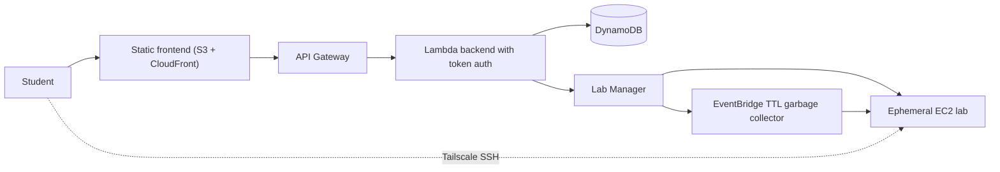

# OSQ

A governed lab-provisioning platform for teaching Linux, database administration, and DevOps scenarios on AWS. Students sign in with a personal access token, request a lab from the web UI, and receive an isolated EC2 environment that is reachable only over Tailscale SSH and destroyed automatically after a fixed 60-minute TTL.

This repository is an 8-week academic proof of concept built by a team of four. All confirmed scope decisions, including what is intentionally out of scope, are recorded in [docs/PROJECT_SCOPE.md](docs/PROJECT_SCOPE.md).

## How it works

1. The student opens the web UI and signs in with a personal access token.
2. The backend validates the token hash stored in DynamoDB and enforces the user's role and lab quota.
3. The Lab Manager creates a session with a fixed 60-minute TTL and requests a short-lived Tailscale auth key.
4. An EC2 instance is launched from a Terraform-approved launch template using the AWS SDK. Terraform is never run per lab request.
5. The instance joins the tailnet on first boot. The session becomes READY only after Tailscale access is confirmed.
6. The student connects with `tailscale ssh student@<host>OSQ.ts.net`. Port 22 is never open to the internet.
7. When the TTL expires, a scheduled garbage collector terminates the instance and writes an audit entry.

## Architecture



The platform is divided into five planes: learner frontend, control plane, lab plane, access plane, and governance and audit plane, as defined in [docs/05-platform-architecture.md](docs/05-platform-architecture.md). Detailed diagrams are in [diagrams/](diagrams/README.md).

## Key decisions

| Area | Decision |
| --- | --- |
| Authentication | Personal access tokens, hashed in DynamoDB, sent as a Bearer header. No Cognito or OIDC in the PoC. |
| Access | Tailscale SSH with ephemeral auth keys. No SSH key generation, storage, or delivery. |
| Provisioning | Runtime launches through the AWS SDK from an approved launch template. Terraform manages the baseline only. |
| TTL | 60 minutes by default and maximum, no extension, enforced in five layers. |
| Governance | Terraform, OPA/Conftest, GitHub Actions with OIDC, CloudTrail, AWS Config, SNS alerts. |

## Tech stack

| Layer | Technology |
| --- | --- |
| Infrastructure as Code | Terraform, state in S3 with DynamoDB lock and KMS |
| Policy as Code | Open Policy Agent, Conftest, Rego unit tests |
| CI/CD | GitHub Actions with GitHub OIDC federation (no static AWS keys) |
| Runtime | AWS SDK (Boto3), Lambda, API Gateway, DynamoDB |
| Access | Tailscale, Tailscale SSH |
| Audit | CloudTrail, AWS Config, SNS |

## Repository layout

```text
docs/                       01-18 technical documentation + PROJECT_SCOPE.md
diagrams/                   architecture, sequence, state machine, roadmap
roles/                      four role charters with weekly plans and DoD
frontend/                   static UI with mock API (no build step)
tests/                      Python unit tests for the Lambdas
bootstrap/                  state backend, KMS, SNS, budget alarm
terraform/modules/network/  VPC, subnets, hardened security groups
terraform/modules/data/     DynamoDB users, labs, sessions, activity
terraform/modules/lab/      launch template, lab security group, SSM AMIs
terraform/modules/api/      HTTP API, Lambdas, IAM, KMS, scheduler
terraform/modules/frontend/ private S3 bucket behind CloudFront
terraform/modules/governance/  CloudTrail trail and GuardDuty detector
terraform/environments/dev/ dev environment wiring
lambdas/                    session handler, lab orchestrator, TTL GC
scripts/                    seed_users, seed_labs operator scripts
policies/                   OPA policies, Rego tests, plan fixtures
.github/workflows/          validate, frontend, policy, plan, deploy, drift, security
Makefile                    task entry points
```

## Getting started

Prerequisites for the UI: a browser. For the backend scripts: Python 3.
For infrastructure work: Terraform 1.6+, tflint, and conftest.

```bash
# Frontend, no AWS account needed
make serve              # http://localhost:8080

# Local verification, no AWS account needed
make test               # pytest, Rego tests, frontend smoke test
make lint               # terraform fmt, validate, tflint
make security           # Checkov + TruffleHog

# Infrastructure, requires AWS credentials
make bootstrap          # state backend, KMS, SNS, budget (once per account)
cp terraform/environments/dev/backend.hcl.example terraform/environments/dev/backend.hcl
make init-dev
make plan-dev
make apply-dev
make seed-users         # mint learner tokens (printed once)
make seed-labs          # load the catalog, flags included
make deploy-frontend    # sync the site and invalidate CloudFront
```

The frontend ships with demo tokens for three roles (student, admin, auditor) shown on the sign-in screen. In a deployed environment the same tokens are seeded as hashes by `scripts/seed_users.py`; see [docs/16-api-and-data-model.md](docs/16-api-and-data-model.md).

## Governance

Every infrastructure change passes through formatting, validation, linting, a security scan, a Terraform plan, and an OPA policy check before apply. The canonical policy catalog, including rule IDs and implementation status, is in [docs/10-governance-compliance-audit.md](docs/10-governance-compliance-audit.md); implemented policies and their tests live in [policies/](policies/README.md); the pipeline itself is specified in [docs/17-ci-cd-and-governance.md](docs/17-ci-cd-and-governance.md). Drift and orphaned labs are detected by AWS Config and the garbage collector, and remediation is routed back through Terraform.

## Status

| Component | Status |
| --- | --- |
| Scope, architecture, and technical docs (01-18) | Done |
| Frontend learner UI, 8 views, mock API, token auth | Done, field names match the docs/16 contract |
| State bootstrap, network module | Validated, tests green |
| Session handler, lab orchestrator, TTL GC Lambdas | Implemented, 72 unit tests green |
| `network`, `data`, `lab`, `api`, `frontend`, `governance` modules | Implemented, validated, tested offline, Checkov clean |
| OPA policies (SEC-001, LAB-002) | Implemented with unit tests and fixtures |
| CI: validate, frontend, policy, plan, deploy, drift, security | Implemented |
| Seeding scripts (`make seed-users`, `make seed-labs`) | Implemented |
| AWS Config recorder and rules (docs/10) | Deferred; CloudTrail and GuardDuty cover the audit baseline |
| Pre-baked lab AMIs, Tailscale enrollment | Not started |

The delivery plan for all eight weeks is in [diagrams/07-delivery-roadmap.md](diagrams/07-delivery-roadmap.md).

