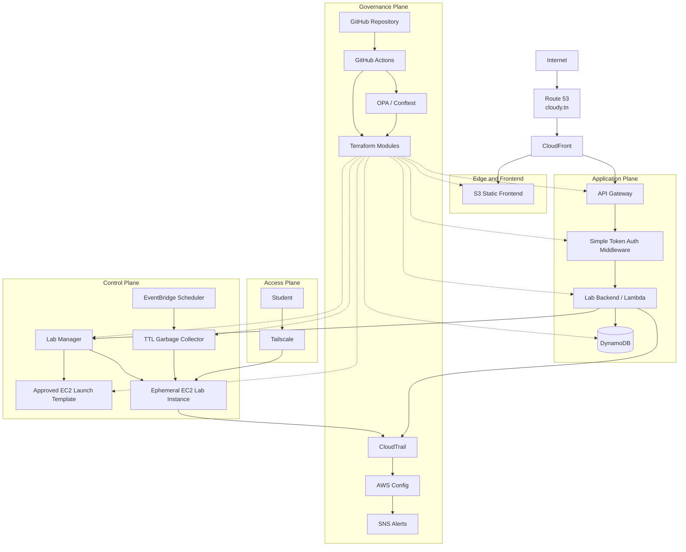

# 01 Proposed Architecture

## Purpose

This diagram shows the updated CloudyBTTounsi architecture.

The platform is divided into:

1. **Edge and Frontend**
   - Route 53
   - CloudFront
   - S3 static frontend

2. **Application Plane**
   - API Gateway
   - simple token authentication middleware
   - backend Lambda or application service
   - DynamoDB

3. **Control Plane**
   - Lab Manager
   - approved EC2 Launch Template
   - ephemeral EC2 lab provisioning
   - TTL garbage collector

4. **Access Plane**
   - Tailscale
   - Tailscale SSH
   - no public SSH

5. **Governance Plane**
   - Terraform
   - OPA
   - GitHub Actions
   - CloudTrail
   - AWS Config
   - SNS alerts

---

## Diagram

---

## Key Architecture Notes

- The frontend is static and hosted on S3.
- CloudFront is optional but recommended.
- The API uses simple token authentication.
- DynamoDB stores users, token hashes, lab sessions, and audit events.
- Labs are not always running.
- EC2 instances are launched only when a lab is requested.
- Every lab has a hard TTL of 60 minutes.
- Student access happens through Tailscale SSH.
- Public SSH is not allowed.
- Terraform governs the baseline infrastructure.
- Runtime provisioning is handled by the AWS SDK for speed.
