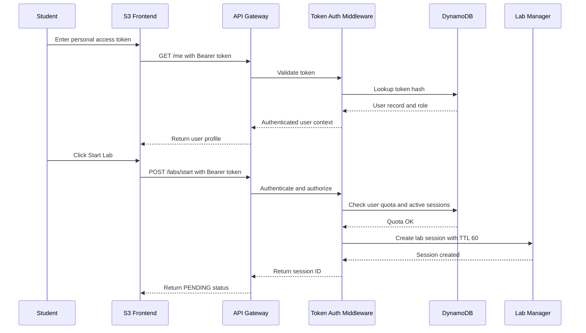

# 02 Simple Authentication and Access Flow

## Purpose

This diagram shows the simplified authentication model for the osq PoC.

The platform does not use Keycloak, Cognito, Auth0, or another dedicated identity engine.

Instead, it uses simple personal access tokens.

---

## Authentication Model

```text
User receives a personal access token.
Token is stored as a hash in DynamoDB.
Frontend sends token as Bearer token.
Backend validates token hash.
Backend checks user role and quota.
Backend allows or denies the request.
```

---

## Diagram



---

## Example API Request

```http
POST /labs/start
Authorization: Bearer cldy_token_abc123
Content-Type: application/json
```

Body:

```json
{
  "labType": "linux"
}
```

---

## Example API Response

```json
{
  "sessionId": "lab-9f2a",
  "userId": "student-01",
  "labType": "linux",
  "status": "PENDING",
  "ttlMinutes": 60
}
```

---

## Security Rules

- Tokens must be hashed before storage.
- Tokens must only be sent over HTTPS.
- Tokens must not be logged.
- Tokens must be revocable.
- Roles must be enforced by the backend.
- Students must not access admin endpoints.
- Auditors must not start labs.

---

