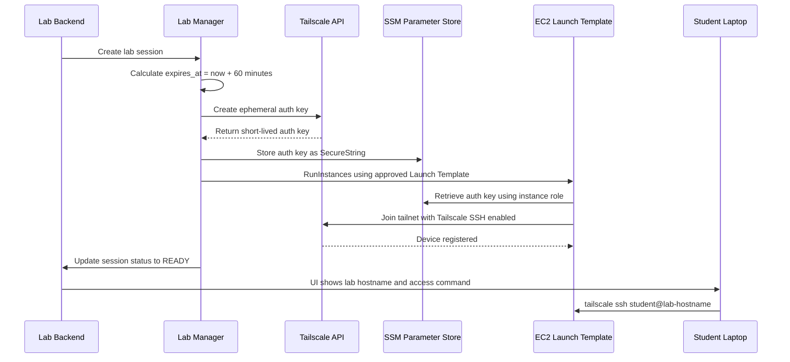

# 03 Dynamic Lab Provisioning Sequence

## Purpose

This diagram shows how a lab is dynamically provisioned only when requested.

The platform uses:

- Terraform-managed Launch Templates
- AWS SDK runtime provisioning
- ephemeral Tailscale auth keys
- session-specific tags
- 60-minute TTL
- automatic garbage collection

---

## Diagram



---

## Session Tags

Every dynamically created lab instance must include these tags:

```text
Project       = cloudybt-tounsi
ManagedBy     = lab-manager
LabType       = linux
SessionId     = lab-9f2a
UserId        = student-01
CreatedAt     = 2026-04-14T10:00:00Z
ExpiresAt     = 2026-04-14T11:00:00Z
TTLMinutes    = 60
AutoDestroy   = true
```

---

## TTL Enforcement

The 60-minute TTL is enforced by:

```text
1. DynamoDB session record
2. EC2 ExpiresAt tag
3. Tailscale ephemeral auth key expiry
4. EventBridge scheduled garbage collector
5. Audit logging
```

---

## Garbage Collection

A scheduled Lambda function runs every 5 minutes.

It performs:

```text
Find all lab instances with ManagedBy = lab-manager
Check ExpiresAt tag
Terminate expired instances
Update session status
Remove stale Tailscale devices if needed
Write audit log
```

---

## Important Note

The platform does not run `terraform apply` for every lab session.

Terraform manages the governed baseline:

```text
VPC
Subnets
Security Groups
IAM roles
SSM parameters
Launch Templates
API infrastructure
Garbage collector infrastructure
```

The application uses the AWS SDK to launch ephemeral labs from the approved template.
