# 04 CI/CD Governance Pipeline

## Purpose

This diagram shows how infrastructure changes are governed before deployment.

Every infrastructure change must pass:

- Terraform formatting
- Terraform validation
- tflint
- Rego unit tests and policy fixtures
- Security scanning (Checkov, TruffleHog)
- Terraform plan
- OPA policy check on the plan JSON
- Manual approval
- Terraform apply

---

## Diagram

```mermaid
flowchart LR
    PR["Developer opens Pull Request"] --> FMT["terraform fmt"]
    FMT --> VAL["terraform validate"]
    VAL --> LINT["tflint"]
    LINT --> FIX["Rego unit tests + fixtures"]
    FIX --> SEC["Security Scan<br/>Checkov + TruffleHog"]
    SEC --> PLAN["terraform plan"]
    PLAN --> OPA["OPA / Conftest<br/>check plan JSON"]

    OPA -->|Fail| BLOCK["Block Pull Request"]
    OPA -->|Pass| APPROVE["Manual Approval"]
    APPROVE --> APPLY["terraform apply"]

    APPLY --> AWS["AWS Resources Updated"]
    AWS --> TRAIL["CloudTrail Logs Change"]
    TRAIL --> CONFIG["AWS Config Evaluates Compliance"]
    CONFIG --> ALERT["Dashboard or SNS Alert"]
```

Workflow files implementing each stage are listed in
[../docs/17-ci-cd-and-governance.md](../docs/17-ci-cd-and-governance.md).

---

## Policy Catalog

The canonical policy IDs, rules, and implementation status are maintained in
[../docs/10-governance-compliance-audit.md](../docs/10-governance-compliance-audit.md).
Do not duplicate that table here; edit it there.

Implemented today:

| Policy ID | Rule | Rego |
|---|---|---|
| `SEC-001` | No security group may expose SSH to the internet | `policies/opa/security/sg_ssh.rego` |
| `LAB-002` | Labs must use approved instance types | `policies/opa/cost/large_instance.rego` |

---

## Notes

- OPA evaluates the Terraform plan JSON before apply; Rego unit tests and
  fixtures run earlier, before credentials are needed.
- Cost estimation (Infracost) is optional and not part of the required gate.
- Production deployments require approval through a protected environment.
- Failed policy checks must explain the remediation, not just the violation.
- The pipeline logs every policy violation for audit purposes.
- A scheduled drift check runs `terraform plan -detailed-exitcode` and reports
  AWS Config status. See [../docs/17-ci-cd-and-governance.md](../docs/17-ci-cd-and-governance.md).
