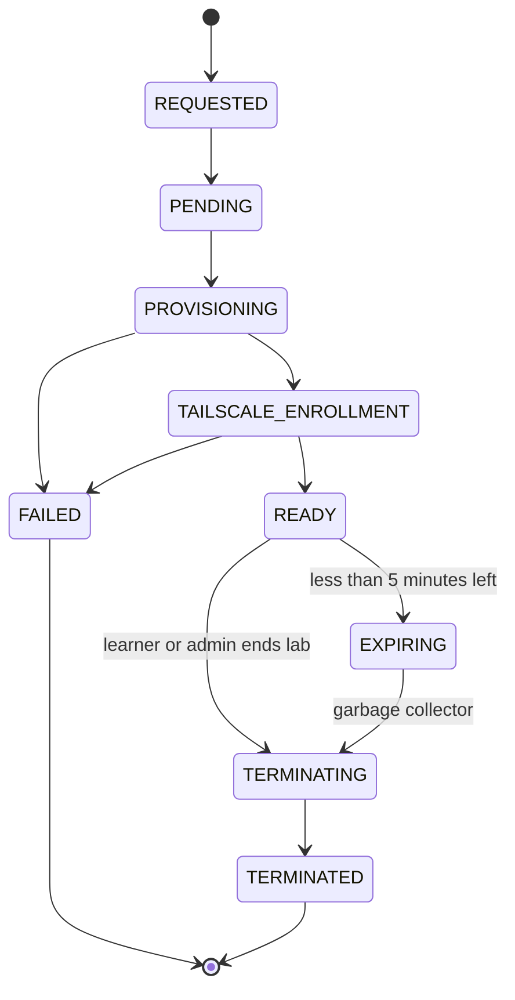

# 05 Lab Lifecycle State Machine

## Purpose

This diagram defines the possible states of a lab session.

It is useful for:

- DynamoDB session table design
- Lab Manager provisioning logic
- cleanup automation
- audit reporting
- frontend status display

The canonical enum values and UI labels are defined in
[`../docs/04-session-lifecycle-and-ttl.md`](../docs/04-session-lifecycle-and-ttl.md).

---

## Diagram



---

## TTL Rules

```text
Default TTL: 60 minutes
Maximum TTL: 60 minutes
Extension: not allowed
```

Recommended warnings:

```text
50 minutes: warning
55 minutes: warning, state becomes EXPIRING
58 minutes: final warning
60 minutes: forced termination
61 minutes: garbage collector cleanup deadline
```

---

## Suggested DynamoDB Fields

Primary key `sessionId`, per
[`../docs/16-api-and-data-model.md`](../docs/16-api-and-data-model.md).

```text
sessions
-------------
sessionId
userId
labId
state
createdAt
expiresAt
endedAt
instanceId
tailscaleHostname
flags
terminationReason
```

---

## Notes

- A lab should not become `READY` until Tailscale access is confirmed.
- Failed sessions should retain the error message for troubleshooting.
- Terminated sessions should remain in DynamoDB for audit history.
- Every lab must have an expiration timestamp.
- No lab session may exceed 60 minutes.
