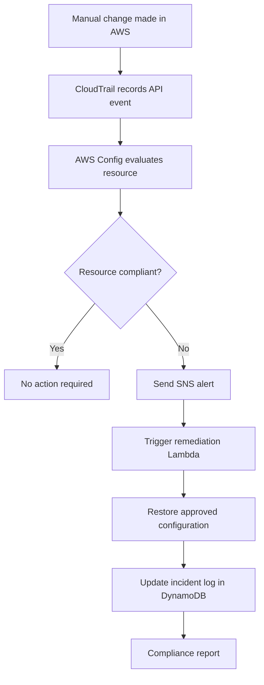

# 06 Drift and Remediation Workflow

## Purpose

This diagram shows what happens when infrastructure changes outside the approved IaC process.

It also covers orphaned lab instances and expired labs that were not terminated correctly.

---

## Diagram



---

## Orphan and TTL Detection

The garbage collector should also detect:

```text
Expired but still running lab instances
Lab instances without ExpiresAt tag
Lab instances without SessionId tag
Lab instances not matching an active session
Stopped lab instances that should be terminated
Orphaned EBS volumes
Stale Tailscale devices
```

---

## Example Drift Scenarios

| Scenario | Risk Level | Response |
|---|---|---|
| Lab security group opened to public SSH | High | Alert and auto-remediate |
| DynamoDB session table deleted or unencrypted | Critical | Alert and restore immediately |
| Lab TTL tag missing | High | Alert and terminate instance |
| Lab instance runs longer than 60 minutes | Medium | Terminate automatically |
| Required tags removed | Low | Alert and re-tag |
| CloudTrail logging disabled | Critical | Alert and re-enable logging |
| DynamoDB point-in-time recovery disabled | High | Alert and restore PITR policy |
| Orphaned EBS volume detected | Low | Alert and delete if expired |

---

## Notes

- AWS Config should monitor EC2, security groups, S3, Lambda, DynamoDB, and IAM resources.
- CloudTrail provides forensic evidence.
- SNS can notify email, Slack, or another alert channel.
- Some drift events should be auto-remediated.
- Dangerous events should require human review before remediation.
