# 07 Delivery Roadmap

## Purpose

This diagram shows the recommended 8-week delivery plan for the updated CloudyBTTounsi PoC.

---

## Diagram

```mermaid
flowchart LR
    W1["Week 1: Repo, DNS, frontend, and scope"] --> W2["Week 2: API, token auth, and DynamoDB"]
    W2 --> W3["Week 3: Terraform baseline and launch templates"]
    W3 --> W4["Week 4: OPA policies and CI/CD pipeline"]
    W4 --> W5["Week 5: Dynamic EC2 provisioning and TTL"]
    W5 --> W6["Week 6: Tailscale SSH and garbage collection"]
    W6 --> W7["Week 7: Audit, drift, and documentation"]
    W7 --> W8["Week 8: Final demo and presentation"]
```

---

## Weekly Ownership

| Week | Person 1: IaC | Person 2: Policy | Person 3: CI/CD | Person 4: Audit |
|---|---|---|---|---|
| Week 1 | Repo structure and architecture | Policy plan | Pipeline design | Audit plan |
| Week 2 | DynamoDB and API infrastructure | Token security rules | Basic CI checks | Session logging design |
| Week 3 | VPC, IAM, launch templates | Launch template policies | Terraform pipeline | CloudTrail setup |
| Week 4 | Backend infrastructure modules | OPA rules and tests | Policy gate pipeline | AWS Config rules |
| Week 5 | Dynamic provisioning modules | TTL and tagging policies | Deployment automation | Expiration audit |
| Week 6 | Tailscale networking assumptions | Access control policies | Garbage collector automation | Orphan detection |
| Week 7 | Documentation and hardening | Policy documentation | Runbooks and scripts | Compliance report |
| Week 8 | Demo support | Demo support | Demo support | Final audit report |

---

## Final Demo Requirements

The final demo should show:

1. A student authenticates with a simple access token.
2. The student requests a Linux lab.
3. The platform creates a session with a 60-minute TTL.
4. The Lab Manager launches an EC2 instance from an approved Launch Template.
5. The EC2 instance joins the Tailscale mesh.
6. The student connects using Tailscale SSH.
7. A dangerous Terraform change is blocked by OPA.
8. An expired lab is terminated automatically.
9. A manual AWS change is detected and reported.

---

## Notes

- The MVP should support one lab type first.
- Additional lab types can be added after the core workflow works.
- Session data should be encrypted at rest from the beginning.
- Tailscale access should be tested before the final demo.
- All lab sessions should be recorded for audit and reporting.
